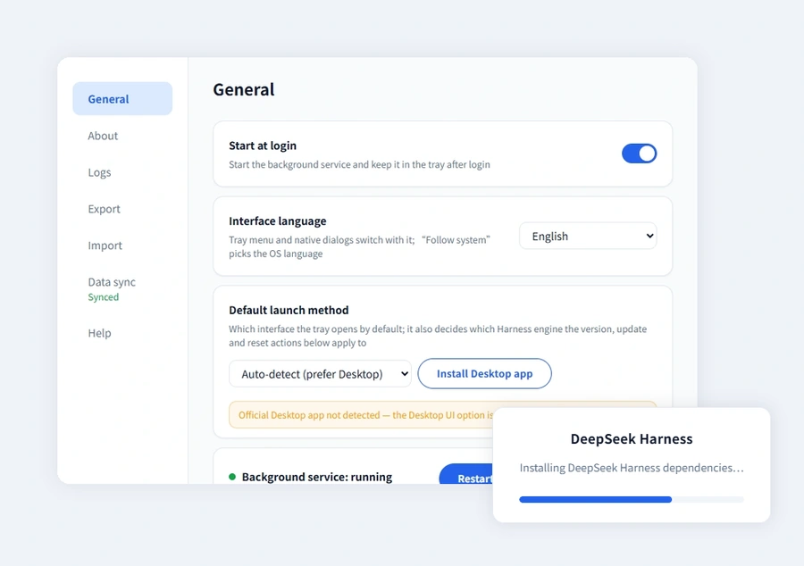

<h1 align="center">
  
  <br />
  dsh-systray
</h1>

<p align="center">
  Launches the
  <a href="https://github.com/deepseek-ai/deepseek-harness">DeepSeek Harness</a>
  Web server in the background and lives in the system tray.
</p>

<p align="center">
  <a href="README.md">简体中文</a> · <a href="README.en.md">English</a>
</p>

<p align="center">
  <a href="https://github.com/refyon/dsh-systray/releases/latest"></a>
  
  
  <a href="https://github.com/refyon/dsh-systray/actions/workflows/build-status.yml"></a>
  <a href="LICENSE"></a>
</p>



**Lightweight**: one file, no install, no admin rights — a single exe on Windows, a single .app on macOS, resident in the tray.
**Reliable**: the environment is checked and provisioned on first start, a failed start rolls back to the last working state, a failed update rolls back automatically, and a service that exits is relaunched.
**Portable**: bundle sessions, plugins and chosen folders into a zip, or keep several machines consistent through account sync.

**[Download](https://github.com/refyon/dsh-systray/releases/latest)** · **[Website](https://refyon.github.io/dsh-systray/)** · **[Changelog](docs/RELEASE_NOTES.md)**

> [!IMPORTANT]
> A community-maintained, unofficial tool that depends on `@deepseek-ai/dsh`. The builds are unsigned — the macOS build is not notarized and the Windows build is not signed — so the first run needs a manual allow. First launch takes about 2–5 minutes to deploy the environment.

## Quick start

| Platform | Download |
| --- | --- |
| Windows x64 | [dsh-systray-windows-x64.zip](https://github.com/refyon/dsh-systray/releases/latest/download/dsh-systray-windows-x64.zip) |
| macOS (Intel + Apple Silicon) | [dsh-systray-macos-universal.zip](https://github.com/refyon/dsh-systray/releases/latest/download/dsh-systray-macos-universal.zip) |

1. Unzip and double-click `dsh-systray.exe` / `dsh-systray.app`, allowing it once — Windows: "More info → Run anyway"; macOS: System Settings → Privacy & Security → Open Anyway, or run this in the unzip folder:

   ```bash
   xattr -dr com.apple.quarantine dsh-systray.app
   ```

2. The window shows environment progress; the first run takes about 2–5 minutes (it downloads a portable Node.js / pnpm and harness on demand — nothing needs to be preinstalled).
3. The tray icon appearing means it is ready: click "Open Web UI" to start working.
4. It then starts with the system. Port, harness directory, language and proxy are on the settings pages.

**What success looks like**: the first tray menu line shows service state, port and timing, and "Open Web UI" opens the harness interface.

## Features

Lightweight: double-click to start (a loopback-only harness Web service, with progress in the window); one exe on Windows, one .app on macOS, no install and no admin rights; tray residency (Open Web UI / Settings / Quit, light/dark follows the system); single instance — a second launch reports "already running".

Reliable: startup self-checks node / pnpm / harness and installs what is missing; a failed start rolls back to the last known-good state and restarts; plugins incompatible with the current harness are marked "Skipped" with the reason on the About page; "Restart service" takes about 4–5 s and a service process that exits is relaunched within 5 minutes (at most 3 times); dsh-systray / Harness / plugins check for updates independently and roll back on failure; private-repo plugins use GitHub device-flow authorization; the Logs page follows `dsh-systray.log` (including rotated archives).

Portable: account sync (email code sign-in) carries start-at-login, the selected Harness version and online plugins — machine-specific settings and local plugins are never uploaded; file/folder sync follows your account with the items you pick (10 MB per account) through a browser-style list; export/import bundles sessions, plugins and chosen folders into a zip, lists restorable items and prompts on conflicts with backups; config in `config.json`, data in `~/.dsh`.

Official Desktop app: when it is detected the tray's "Open Web UI" becomes "Open Desktop UI"; the default launch method is `auto` / `web` / `desktop`, and version, update and reset follow it (Desktop UI uses the official update feed); entries that only affect the tray-managed service are greyed out or hidden in that mode.

## System requirements

| Platform | Requirement |
| --- | --- |
| Windows | Windows 10 1803+ / Windows 11; [WebView2 Runtime](https://developer.microsoft.com/microsoft-edge/webview2/) (preinstalled with Microsoft Edge, installed automatically when missing) |
| macOS | macOS 11.0+ |

## Configuration

`config.json` lives in the user config directory (Windows `%APPDATA%\dsh-systray`, macOS `~/Library/Application Support/dsh-systray`). It is optional — defaults apply when missing:

```json
{
  "port": 3080,
  "harnessDir": "~/deepseek-harness",
  "startupTimeoutSec": 300,
  "updateMirror": "",
  "mirrorBase": "",
  "harnessPrerelease": false,
  "language": "auto",
  "proxy": "auto",
  "trustedHosts": [],
  "accountApiBase": "",
  "launchTarget": "auto"
}
```

| Key | Description | Environment variable |
| --- | --- | --- |
| `port` / `harnessDir` | Server port (default 3080) / harness directory (default `~/deepseek-harness`) | `DSH_SYSTRAY_PORT`, `DSH_SYSTRAY_HARNESS_DIR` |
| `startupTimeoutSec` | Startup wait timeout in seconds, default 300 | `DSH_SYSTRAY_STARTUP_TIMEOUT` |
| `updateMirror` / `mirrorBase` | GitHub download mirror prefix / self-hosted relay URL | — |
| `harnessPrerelease` | Treat alpha/beta/rc as updateable versions | — |
| `language` / `proxy` | UI language `auto` / `zh` / `en`; outbound proxy `auto` / `direct` / URL | `DSH_SYSTRAY_LANG`, `DSH_SYSTRAY_PROXY` |
| `trustedHosts` / `accountApiBase` | Extra trusted addresses (`host:port`) / account-sync service URL | — |
| `launchTarget` | Default launch method `auto` / `web` / `desktop` | `DSH_SYSTRAY_LAUNCH_TARGET` |

Environment variables win over the file. Logs live in the app's own log directory (the Logs page shows the full path and can clear it), data lives in `~/.dsh`, and start-at-login writes a registry entry (Windows) or login item (macOS).

## Building

Prerequisites: Go 1.21+ and the [Wails CLI v2](https://wails.io/docs/gettingstarted/installation) (`go install github.com/wailsapp/wails/v2/cmd/wails@v2.15.0`). Run commands inside `src/`; on Windows you can also use `scripts\build.ps1`.

| Platform | Build command (run inside `src/`) |
| --- | --- |
| Windows | `wails build -s -clean -platform windows/amd64 -ldflags "-X main.appVersion=v1.3.6"` |
| macOS | `wails build -s -clean -platform darwin/universal -ldflags "-X main.appVersion=v1.3.6"` |

Output: `src/build/bin/dsh-systray.exe` / `dsh-systray.app`. The version is injected from the CI tag; when omitted it is `dev`, which skips update checks. On Windows add `-webview2 download` to cover machines without WebView2. Development mode: `cd src && wails dev`.

Debug environment variables: `DSH_SYSTRAY_PORT`, `DSH_SYSTRAY_HARNESS_DIR`, `DSH_SYSTRAY_STARTUP_TIMEOUT`, `DSH_SYSTRAY_LOG_DIR`, `DSH_SYSTRAY_LANG`, `DSH_SYSTRAY_PROXY`.

## Testing

```bash
cd src && go test ./...                    # Go: file sync / account / update / service watchdog regressions
node scripts/check-frontend-i18n.mjs       # Translation keys: data-i18n ↔ I18N_EN, tr/fmt/msg literals ↔ I18N_DYN
node scripts/check-frontend-files-card.mjs # File list: size formatting, tree aggregation, sorting, rows, navigation
node scripts/check-frontend-lang.mjs       # Real browser: 7 pages × zh/en baselines + live language switch + scenarios
```

For any UI or wording change run at least the last three. The first two are static/pure-function checks; the third renders the same UI twice — started in the target language vs switched to it — and reports every element whose text did not follow (`--shot dir/` also saves screenshots, `--page sync` limits the run to one page). It needs a local Edge/Chrome. Behaviour that only exists in the packaged app (install location, start-at-login, cancelling system dialogs) still has to be verified on a real machine.

## FAQ

<details>
<summary>The first run is blocked by the system (Windows SmartScreen / macOS "cannot be opened")</summary>

The builds are unsigned. On Windows click "More info → Run anyway". On macOS use System Settings → Privacy & Security → Open Anyway, or run `xattr -dr com.apple.quarantine dsh-systray.app` in the unzip folder to clear the quarantine flag left by the browser download. One allow per download is enough.
</details>

<details>
<summary>Why does the first start take 2–5 minutes</summary>

The first start deploys the runtime on your machine: a portable Node.js, pnpm and DeepSeek Harness are downloaded on demand, with progress shown in the window. Nothing has to be preinstalled. Later starts are a matter of seconds, and "Restart service" takes about 4–5 s.
</details>

<details>
<summary>Does it upload my data</summary>

Without account sync the app uploads nothing and the service listens on loopback only. With account sync enabled, the uploaded set is exactly: the start-at-login switch, the selected Harness version (including the prerelease channel) and the list of online plugins — machine-specific settings (directories, ports) and local-source plugins are not synced. File/folder sync is a separate, explicit feature (10 MB per account) that only carries the files and folders you pick.
</details>

<details>
<summary>Port 3080 is taken or reserved by the system</summary>

Startup detects this and offers a one-click switch to another port. You can also change the port on the General settings page or set `DSH_SYSTRAY_PORT`. A port change takes effect after the service restarts.
</details>

<details>
<summary>Can a failed update break the environment</summary>

No. dsh-systray, Harness and plugins check for updates independently and roll back to the pre-update state on failure, reporting the reason. A failed Harness update still leaves the last working version in place.
</details>

<details>
<summary>How do I uninstall completely</summary>

Quit the tray app, switch start-at-login off, then delete the program files (exe / .app), `~/.dsh`, the user config directory (Windows `%APPDATA%\dsh-systray`, macOS `~/Library/Application Support/dsh-systray`), the harness directory (default `~/deepseek-harness`) and the portable runtime provisioned next to the app. On Windows, if an entry is left behind, remove `DeepSeekHarness` under `HKCU\Software\Microsoft\Windows\CurrentVersion\Run`.
</details>

<details>
<summary>Can I use Harness without dsh-systray</summary>

Yes. This app is only a launcher: Harness lives in the harness directory and its data in `~/.dsh`, so you can start `dsh` (or the launcher inside the harness directory) yourself — nothing depends on the tray app running.
</details>

## Known limitations

- The builds are unsigned: the macOS build is not notarized and the Windows build is not code-signed, so the first run needs a manual allow.
- The app is not sandboxed: it writes to `~/.dsh` and to its own config directory, and adds a registry entry (Windows) or login item (macOS) when start-at-login is on.
- At runtime it downloads and provisions Node.js, pnpm and DeepSeek Harness on your machine; those components keep their own upstream licences.
- Synced files are capped at 10 MB per account and only cover the items you explicitly select.
- An unofficial tool, unaffiliated with DeepSeek; upstream API or layout changes may affect it.

## Contributing

Issues and pull requests are welcome. Read [CONTRIBUTING.md](CONTRIBUTING.md) first: it covers the development setup, the four checks to run before opening a pull request, and the house rules (comments and commit subjects are in Chinese; user-facing strings go through the i18n layer).

- Bugs and feature requests: [open an issue](https://github.com/refyon/dsh-systray/issues/new/choose) (templates provided)
- Security problems: **do not** open a public issue — use the private channel in [SECURITY.md](SECURITY.md)
- UI changes must follow [DESIGN.md](docs/DESIGN.md) (colours and spacing from tokens, dialogs come to the front)

## License

[MIT](LICENSE) © 2026 RefyonLab

The code in this repository is MIT-licensed. At runtime it downloads and provisions Node.js, pnpm and DeepSeek Harness on your machine; those components keep their own upstream licences.

## Related links

[Website](https://refyon.github.io/dsh-systray/) · [DeepSeek Harness](https://github.com/deepseek-ai/deepseek-harness) · [Wails](https://wails.io/)

If this tool is useful to you, a ⭐ on GitHub is the most direct way to support the project.
