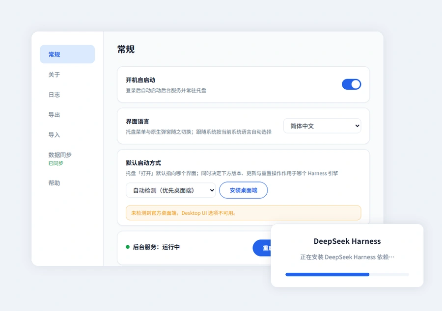

<h1 align="center">
  
  <br />
  dsh-systray
</h1>

<p align="center">
  后台启动
  <a href="https://github.com/deepseek-ai/deepseek-harness">DeepSeek Harness</a>
  Web 本地服务器，并常驻系统托盘。
</p>

<p align="center">
  <a href="README.md">简体中文</a> · <a href="README.en.md">English</a>
</p>

<p align="center">
  <a href="https://github.com/refyon/dsh-systray/releases/latest"></a>
  
  
  <a href="https://github.com/refyon/dsh-systray/actions/workflows/build-status.yml"></a>
  <a href="LICENSE"></a>
</p>


**轻量**：单文件免安装、免管理员权限，Windows 为单个 exe、macOS 为单个 .app，托盘常驻。
**可靠**：启动自检环境并按需安装，启动失败回退上次正常状态，更新失败自动回滚；服务进程意外退出会自动拉起。
**可迁移**：会话 / 插件 / 自选文件目录打包导出导入，账号同步让多台机器保持一致。

**[下载](https://github.com/refyon/dsh-systray/releases/latest)** · **[网站](https://refyon.github.io/dsh-systray/)** · **[变更记录](docs/RELEASE_NOTES.md)**

> [!IMPORTANT]
> 社区维护的非官方工具，依赖 `@deepseek-ai/dsh`。构建未签名：macOS 版未经公证、Windows 版未签名，首次运行需手动放行。首次启动约 2–5 分钟部署环境。

## 快速上手

| 平台 | 下载 |
| --- | --- |
| Windows x64 | [dsh-systray-windows-x64.zip](https://github.com/refyon/dsh-systray/releases/latest/download/dsh-systray-windows-x64.zip) |
| macOS（Intel + Apple Silicon） | [dsh-systray-macos-universal.zip](https://github.com/refyon/dsh-systray/releases/latest/download/dsh-systray-macos-universal.zip) |

1. 解压压缩包，双击 `dsh-systray.exe` / `dsh-systray.app`；首次运行放行一次——Windows「更多信息 → 仍要运行」，macOS 走「系统设置 → 隐私与安全性 → 仍要打开」，或在解压目录执行：

   ```bash
   xattr -dr com.apple.quarantine dsh-systray.app
   ```

2. 窗口内显示环境部署进度，首次约 2–5 分钟（自动下载便携 Node.js / pnpm 与 harness，无需预装）。
3. 托盘出现图标即已就绪，菜单首行显示服务状态与端口；点「打开 Web UI」开始使用。
4. 就绪后随系统开机自启；端口、Harness 目录、语言、代理等在设置窗口调整。

## 功能



轻量：双击启动（仅监听本机的 harness Web 服务，进度在窗口内显示）；Windows 单 exe、macOS 单 .app，免安装、免管理员权限；托盘常驻（打开 Web UI / 设置 / 退出，深浅色随系统）；单实例，重复启动提示「已在运行中」。

可靠：启动自检 node / pnpm / harness 并自动补装；启动失败回退上次正常状态并重启；插件与 harness 不兼容时在关于页标注「已被跳过」与原因；「重启服务」约 4–5 秒，服务进程退出后 5 分钟内自动拉起（最多 3 次）；dsh-systray / Harness / 插件按模块独立检查更新，失败自动回滚；私有仓库插件走 GitHub 设备流授权；日志页跟踪 `dsh-systray.log`（含轮转归档）。

可迁移：账号同步（邮箱验证码登录）同步开机自启动、选用版本与在线插件，本机配置与本地插件不上传；文件 / 文件夹同步把自选条目随账号带走（每账号 10 MB），列表为浏览器式导航；导出 / 导入把会话、插件、自选目录打包为 zip，导入时罗列可恢复项、冲突询问并备份；配置在 `config.json`，数据在 `~/.dsh`。

官方桌面端：检测到桌面端后托盘「打开 Web UI」变为「打开 Desktop UI」；默认启动方式可选 `auto` / `web` / `desktop`，版本、更新与重置随其切换（Desktop UI 用官方更新源）；仅影响托盘服务的条目在该模式下置灰或隐藏。

## 系统要求

| 平台 | 要求 |
| --- | --- |
| Windows | Windows 10 1803+ / Windows 11；[WebView2 Runtime](https://developer.microsoft.com/microsoft-edge/webview2/)（随 Microsoft Edge 预装，缺失时自动安装） |
| macOS | macOS 11.0+ |

## 配置

`config.json` 位于用户配置目录（Windows `%APPDATA%\dsh-systray`、macOS `~/Library/Application Support/dsh-systray`），可选，缺失时用默认值：

```json
{
  "port": 3080,
  "harnessDir": "~/deepseek-harness",
  "startupTimeoutSec": 300,
  "updateMirror": "",
  "mirrorBase": "",
  "harnessPrerelease": false,
  "language": "auto",
  "proxy": "auto",
  "trustedHosts": [],
  "accountApiBase": "",
  "launchTarget": "auto"
}
```

| 键 | 说明 | 环境变量 |
| --- | --- | --- |
| `port` / `harnessDir` | 服务端口（默认 3080）/ harness 目录（默认 `~/deepseek-harness`） | `DSH_SYSTRAY_PORT`、`DSH_SYSTRAY_HARNESS_DIR` |
| `startupTimeoutSec` | 服务启动等待超时（秒），默认 300 | `DSH_SYSTRAY_STARTUP_TIMEOUT` |
| `updateMirror` / `mirrorBase` | GitHub 下载镜像前缀 / 自建中转地址 | — |
| `harnessPrerelease` | 是否把 alpha/beta/rc 视为可更新版本 | — |
| `language` / `proxy` | 界面语言 `auto` / `zh` / `en`；出网代理 `auto` / `direct` / 地址 | `DSH_SYSTRAY_LANG`、`DSH_SYSTRAY_PROXY` |
| `trustedHosts` / `accountApiBase` | 额外信任的访问地址（`host:port`）/ 账号同步服务地址 | — |
| `launchTarget` | 默认启动方式 `auto` / `web` / `desktop` | `DSH_SYSTRAY_LAUNCH_TARGET` |

环境变量优先于文件。日志在应用自身日志目录（日志页可查看完整路径并清空），数据在 `~/.dsh`，开机自启写注册表（Windows）或启动项（macOS）。

## 构建

前置：Go 1.21+ 与 [Wails CLI v2](https://wails.io/docs/gettingstarted/installation)（`go install github.com/wailsapp/wails/v2/cmd/wails@v2.15.0`）；命令在 `src/` 下执行，Windows 也可用 `scripts\build.ps1`。

| 平台 | 构建命令（在 `src/` 下执行） |
| --- | --- |
| Windows | `wails build -s -clean -platform windows/amd64 -ldflags "-X main.appVersion=v1.3.6"` |
| macOS | `wails build -s -clean -platform darwin/universal -ldflags "-X main.appVersion=v1.3.6"` |

产物：`src/build/bin/dsh-systray.exe` / `dsh-systray.app`。版本号由 CI 按 tag 注入，省略时为 `dev`（跳过更新检查）；Windows 可加 `-webview2 download` 为未预装 WebView2 的机器兜底。开发模式：`cd src && wails dev`。

调试环境变量：`DSH_SYSTRAY_PORT`、`DSH_SYSTRAY_HARNESS_DIR`、`DSH_SYSTRAY_STARTUP_TIMEOUT`、`DSH_SYSTRAY_LOG_DIR`、`DSH_SYSTRAY_LANG`、`DSH_SYSTRAY_PROXY`。

## 测试

```bash
cd src && go test ./...                    # Go：文件同步 / 账号 / 更新 / 服务守护等回归
node scripts/check-frontend-i18n.mjs       # 文案键齐全：静态 data-i18n ↔ I18N_EN、tr/fmt/msg 字面量 ↔ I18N_DYN
node scripts/check-frontend-files-card.mjs # 文件列表：容量换算、目录树聚合、排序、行渲染、导航与路径行规则
node scripts/check-frontend-lang.mjs       # 真实浏览器：7 个页面 × 中英基线 + 运行中切换语言 + 交互场景（需本机 Edge/Chrome）
```

界面文案改动请至少跑后三条：前两条是静态/纯函数检查，第三条会用同一份界面比对「以目标语言直接启动」与「切换语言后」的逐元素文案，漏刷新的按钮/提示会被直接列出（`--shot 目录/` 可顺带截图复核）。真实安装包层面的操作（安装位置、开机自启、系统对话框取消等）仍需在真机走一遍。

## 常见问题

<details>
<summary>首次运行被系统拦下（Windows SmartScreen / macOS 无法打开）</summary>

构建未签名：Windows 点「更多信息 → 仍要运行」；macOS 走「系统设置 → 隐私与安全性 → 仍要打开」，或在解压目录执行 `xattr -dr com.apple.quarantine dsh-systray.app` 清掉浏览器下载留下的隔离标记。同一份包只需放行一次。
</details>

<details>
<summary>为什么首次启动要 2–5 分钟</summary>

首次启动会在本机部署运行环境：按需下载便携 Node.js、pnpm 与 DeepSeek Harness，进度显示在窗口内，无需预装任何依赖。之后就绪启动通常在数秒内完成（「重启服务」约 4–5 秒）。
</details>

<details>
<summary>会上传我的数据吗</summary>

不开启账号同步时，应用不出网上传任何内容，服务仅监听本机。开启账号同步后，上传范围只有：开机自启动开关、选用的 Harness 版本（含预发布通道）、在线插件清单；本机目录、端口等环境配置与本地来源插件不同步。文件目录同步是显式的单独功能（每账号 10 MB），只同步你手动选中的文件与文件夹。
</details>

<details>
<summary>端口 3080 被占用或被系统保留怎么办</summary>

应用会在启动时检测并提示，给出一键改用其它端口的入口；也可在设置窗口「常规」页改端口，或设置环境变量 `DSH_SYSTRAY_PORT`。改端口后需重启服务生效。
</details>

<details>
<summary>更新失败会不会把环境弄坏</summary>

不会：dsh-systray、Harness、插件各自独立检查更新，失败自动回滚到更新前的状态并提示原因。Harness 更新失败时仍可回到上次正常运行的版本。
</details>

<details>
<summary>如何彻底卸载</summary>

退出托盘应用并关闭自启动开关后，删除程序文件（exe / .app）、`~/.dsh`、用户配置目录（Windows `%APPDATA%\dsh-systray`、macOS `~/Library/Application Support/dsh-systray`）、harness 目录（默认 `~/deepseek-harness`）与随应用部署的便携运行时。Windows 若残留自启动项，删除注册表 `HKCU\Software\Microsoft\Windows\CurrentVersion\Run` 下的 `DeepSeekHarness`。
</details>

<details>
<summary>能脱离 dsh-systray 直接用 Harness 吗</summary>

可以。本应用只是启动器：Harness 装在 harness 目录、数据在 `~/.dsh`，用 `dsh`（或 harness 目录里的启动方式）自行启动即可，不依赖托盘程序运行。
</details>

## 已知限制

- 构建未签名：macOS 版未经公证、Windows 版未签名，首次运行需手动放行。
- 应用未做沙箱：会把数据写入 `~/.dsh` 与自身配置目录，开启自启动时会写注册表（Windows）或启动项（macOS）。
- 运行时会按需下载并在本机部署 Node.js、pnpm 与 DeepSeek Harness，三者遵循各自上游许可。
- 数据同步的文件容量上限为每账号 10 MB，仅同步你显式选中的条目。
- 非官方工具，与 DeepSeek 官方无关；上游 API 与目录结构变动可能影响功能。

## 贡献

欢迎 issue 与 pull request。动手前请先读 [CONTRIBUTING.md](CONTRIBUTING.md)：里面有开发环境、提交前必须跑的四条检查，以及本项目「代码注释与提交信息用中文、界面文案走 i18n」的约定。

- 缺陷 / 功能建议：[新建 issue](https://github.com/refyon/dsh-systray/issues/new/choose)（已提供模板）
- 使用问题、想法与配置分享：[Discussions](https://github.com/refyon/dsh-systray/discussions)
- 安全漏洞：**不要**开公开 issue，走 [SECURITY.md](SECURITY.md) 的私密报告渠道
- 界面设计改动须遵循 [DESIGN.md](docs/DESIGN.md)（颜色与间距走 token、弹窗必须前台）

## 许可

[MIT](LICENSE) © 2026 RefyonLab

仓库自身的代码按 MIT 授权；运行时会按需下载并在本机部署 Node.js、pnpm 与 DeepSeek Harness，这些组件各自遵循其上游许可。

## 相关链接

[网站](https://refyon.github.io/dsh-systray/) · [DeepSeek Harness](https://github.com/deepseek-ai/deepseek-harness) · [Wails](https://wails.io/)

如果这个工具对你有用，欢迎在 GitHub 上点个 Star ⭐ —— 这是对项目最直接的支持。
